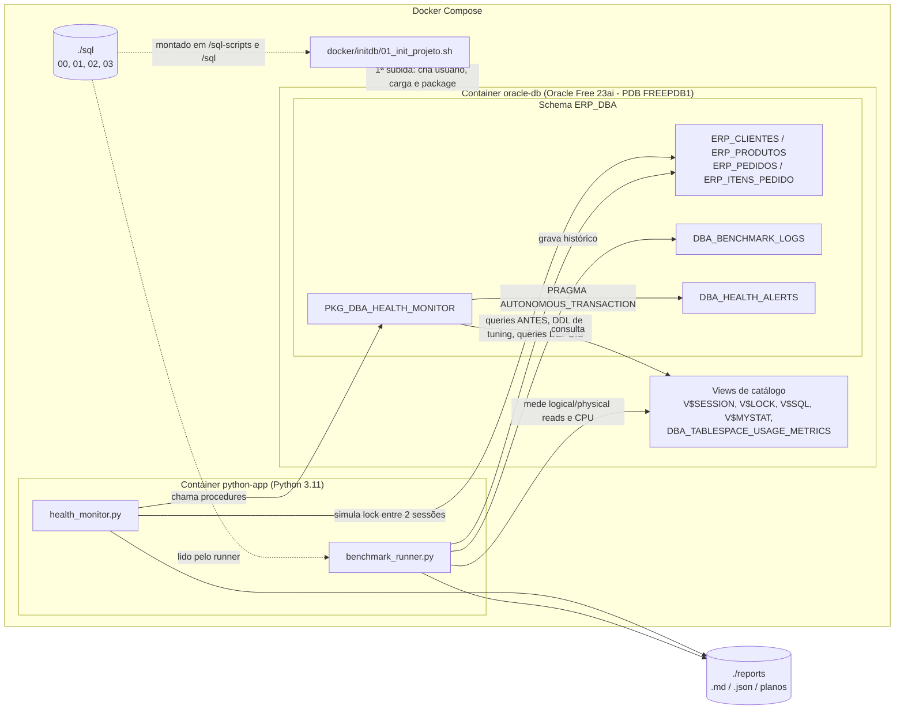

# Oracle Performance Tuning & Health Monitor

> Laboratório prático e reproduzível de **tuning de SQL** e **monitoramento de saúde** em Oracle Database, com ambiente 100% em Docker, massa de dados realista de ERP (3,65 milhões de linhas) e benchmark automatizado de **antes e depois**.


---

## 1. Visão geral e problema de negócio

Em ERPs corporativos, relatórios de faturamento, conferências de pedidos pendentes e análises de estoque costumam começar rápidos e **degradar com o crescimento dos dados**. As causas são recorrentes:

- chaves estrangeiras e colunas de filtro **sem índice**;
- **funções na cláusula `WHERE`** (`TRUNC(data)`) que impedem o uso de índices;
- `SELECT *` e `IN` com subqueries amplas;
- **estatísticas desatualizadas**, que levam o otimizador a estimar cardinalidades erradas.

Este projeto reproduz esse cenário de propósito e mostra, com números, o efeito de cada correção:

| Camada | O que entrega |
|---|---|
| **Banco (PL/SQL)** | Schema de ERP com 100 mil clientes, 50 mil produtos, 1 milhão de pedidos e 2,5 milhões de itens; package `PKG_DBA_HEALTH_MONITOR` (locks, bloqueadores, tablespaces, Top SQL, log em transação autônoma) |
| **Laboratório de tuning** | 3 queries críticas em versão lenta e otimizada, com `EXPLAIN PLAN` e `DBMS_XPLAN` |
| **Python** | `benchmark_runner.py` (mede, aplica o tuning, compara e grava histórico) e `health_monitor.py` (diagnóstico, simulação de lock, exportação `.md`/`.json`) |

## 2. Arquitetura



## 3. Estrutura do projeto

```text
oracle-performance-tuning-monitor/
├── docker-compose.yml
├── Dockerfile
├── requirements.txt
├── .env.example
├── .gitignore / .gitattributes
├── README.md
├── docker/
│   └── initdb/
│       └── 01_init_projeto.sh        # roda 00, 01 e 02 na 1ª inicialização do Oracle
├── sql/
│   ├── 00_setup_usuario.sql          # usuário ERP_DBA + grants diretos em V$/DBA_
│   ├── 01_schema_e_carga.sql         # DDL, carga massiva, gargalos propositais
│   ├── 02_pkg_health_monitor.sql     # PKG_DBA_HEALTH_MONITOR
│   └── 03_tuning_lab.sql             # RESET, ANTES, TUNING, DEPOIS, EXPLAIN PLAN
├── app/
│   ├── common.py                     # conexão, espera pelo banco, helpers
│   ├── benchmark_runner.py
│   └── health_monitor.py
├── docs/
│   └── POST_LINKEDIN.md
└── reports/                          # relatórios e planos gerados (ignorado pelo Git)
```

## 4. Como executar

**Pré-requisitos:** Docker e Docker Compose v2; cerca de **4 GB de RAM** liberados para o Docker e **8 GB de disco**. Funciona em Linux, Windows (WSL2) e macOS (inclusive Apple Silicon).

```bash
# 1) clonar
git clone https://github.com/<seu-usuario>/oracle-performance-tuning-monitor.git
cd oracle-performance-tuning-monitor

# 2) (opcional) trocar as senhas padrão
cp .env.example .env

# 3) subir o ambiente (a 1ª subida baixa a imagem e executa a carga; leva alguns minutos)
docker compose up -d --build

# 4) acompanhar a carga (aguarde "DATABASE IS READY TO USE!")
docker compose logs -f oracle-db

# 5) conferir que o banco está "healthy"
docker compose ps

# 6) rodar o benchmark antes x depois
docker compose exec app python benchmark_runner.py

# 7) rodar o monitor de saúde (com simulação de lock)
docker compose exec app python health_monitor.py
```

Opções úteis:

```bash
docker compose exec app python benchmark_runner.py --runs 5 --only Q1 Q3   # 5 execuções, só Q1 e Q3
docker compose exec app python benchmark_runner.py --history               # histórico em DBA_BENCHMARK_LOGS
docker compose exec app python health_monitor.py --no-simulate-lock        # snapshot sem simular lock
docker compose exec app python health_monitor.py --watch 30                # monitoramento contínuo
docker compose exec app python health_monitor.py --export json             # apenas JSON
```

Os relatórios (`.md`, `.json`) e os planos de execução são gravados em `./reports`.

**Acesso direto ao banco** (SQL Developer, DBeaver etc.): host `localhost`, porta `1521`, service name `FREEPDB1`, usuário `erp_dba`, senha `ErpDba_2025` (ou a definida no `.env`).

**Executar o laboratório manualmente:**

```bash
docker compose exec oracle-db sqlplus erp_dba/ErpDba_2025@//localhost:1521/FREEPDB1 @/sql-scripts/03_tuning_lab.sql
```

**Recomeçar do zero** (apaga o volume e refaz a carga): `docker compose down -v && docker compose up -d --build`.

> Os scripts de `docker/initdb` só rodam quando o volume de dados está vazio. O benchmark é repetível: a cada execução ele faz o `RESET` (remove os índices do laboratório e restaura as estatísticas desatualizadas).

## 5. O cenário "problemático" (de propósito)

| Gargalo | Como é criado |
|---|---|
| Sem índices em FKs | `ERP_PEDIDOS.CLI_ID`, `ERP_ITENS_PEDIDO.PED_ID` e `PRD_ID` só têm a constraint (`ENABLE NOVALIDATE`), sem índice de apoio |
| Sem índices em colunas de filtro | `PED_DATA`, `PED_STATUS`, `CLI_REGIAO`, `CLI_ATIVO` |
| Estatísticas desatualizadas | Após a carga, `DBMS_STATS.SET_TABLE_STATS` reduz `NUM_ROWS` para ~10% do real e `LOCK_TABLE_STATS` impede a coleta automática |
| Carga eficiente | `FORALL` em lotes (clientes) e `INSERT /*+ APPEND */` com geradores `CONNECT BY` (demais tabelas) |

## 6. Técnicas de tuning aplicadas

### 6.1 SARGability (Search ARGument ABLE)
Um predicado é *SARGable* quando o otimizador consegue usar a coluna "limpa" para navegar em um índice. Ao aplicar uma função na coluna, o índice deixa de ser utilizável para aquele predicado:

```sql
-- Antes: função na coluna, o índice de PED_DATA não é usado (e o dado tem hora)
WHERE TRUNC(p.ped_data) BETWEEN DATE '2025-03-01' AND DATE '2025-03-31'

-- Depois: intervalo semiaberto, sem função na coluna
WHERE p.ped_data >= DATE '2025-03-01' AND p.ped_data < DATE '2025-04-01'
```

O intervalo semiaberto (`>=` início e `<` dia seguinte) também cobre corretamente registros com componente de hora, o que o `BETWEEN ... '2025-03-31'` direto na coluna deixaria de fora.

### 6.2 `EXISTS` vs `IN`
- `EXISTS` expressa "existe ao menos uma linha" e permite ao otimizador um **semi-join** que para na primeira correspondência.
- **Ponto de honestidade técnica:** o Oracle moderno frequentemente transforma `IN` com subquery em semi-join automaticamente. Por isso, neste laboratório, o ganho vem da **combinação** SARGability + índices + estatísticas + projeção enxuta; a reescrita para `EXISTS` torna a intenção explícita e o plano previsível.
- A diferença de **semântica** pesa com `NOT IN` (resultado vazio se a subquery retornar `NULL`) versus `NOT EXISTS`, que é o padrão seguro.

### 6.3 Índices compostos e *covering*
| Índice | Colunas | Motivo |
|---|---|---|
| `IDX_PED_DATA_STATUS_COV` | `(ped_data, ped_status, ped_id, cli_id, ped_valor_total)` | Range scan por data, status filtrado no índice e **todas as colunas necessárias** presentes (sem acesso à tabela) |
| `IDX_PED_CLI_DATA` | `(cli_id, ped_data)` | Índice da FK de pedidos |
| `IDX_ITM_PED_COV` | `(ped_id, prd_id, itm_qtd, itm_qtd_entregue)` | Suporta o `EXISTS` de itens pendentes sem ler a tabela |
| `IDX_ITM_PRD` | `(prd_id)` | Índice da FK para produtos |
| `IDX_CLI_REGIAO_ATIVO` | `(cli_regiao, cli_ativo)` | Filtros de região/ativo |

Regra de ordenação das colunas: igualdade e intervalo mais seletivo primeiro, colunas só de projeção por último. O custo: cada índice aumenta o tempo de DML e o espaço em disco; por isso o laboratório cria apenas o necessário. Em tabelas pequenas, o otimizador pode corretamente preferir *full scan* e não usar o índice.

### 6.4 `DBMS_STATS`
O otimizador decide com base nas estatísticas. Com `NUM_ROWS` subestimado, as estimativas de cardinalidade ficam erradas e o plano escolhido pode ser ruim. O tuning executa:

```sql
DBMS_STATS.UNLOCK_TABLE_STATS(...);
DBMS_STATS.GATHER_TABLE_STATS(ownname, tabname,
    estimate_percent => DBMS_STATS.AUTO_SAMPLE_SIZE,
    method_opt       => 'FOR ALL COLUMNS SIZE AUTO',  -- histogramas onde há skew (ex.: PED_STATUS)
    cascade          => TRUE);                         -- inclui os índices novos
```

### 6.5 Análise de `EXPLAIN PLAN`
```sql
EXPLAIN PLAN SET STATEMENT_ID = 'Q1_ANTES' FOR <query>;
SELECT * FROM TABLE(DBMS_XPLAN.DISPLAY('PLAN_TABLE', 'Q1_ANTES', 'TYPICAL'));
```
O que comparar entre os planos (salvos em `reports/plans/<run_id>/`):

| Procure por | Antes | Depois |
|---|---|---|
| Método de acesso | `TABLE ACCESS FULL` em pedidos/itens | `INDEX RANGE SCAN` nos índices novos |
| Predicados | `filter(TRUNC(...))` | `access(PED_DATA >= ... AND PED_DATA < ...)` |
| Cardinalidade (`Rows`) | Subestimada (estatísticas antigas) | Próxima do real |
| Subqueries | `IN` | `SEMI JOIN` explícito para `EXISTS` |
| Colunas lidas | `SELECT *` | Apenas as necessárias (nenhum acesso à tabela quando o índice cobre) |

### 6.6 Como o benchmark mede
Para cada query/fase, o runner executa `--runs` vezes (padrão 3), consome **todas** as linhas e registra a **execução mediana**: tempo decorrido (`perf_counter`), `session logical reads`, `physical reads` e CPU (via `V$MYSTAT`). Também compara a **quantidade de linhas** entre as versões para sinalizar divergência de resultado. Cada execução tem timeout configurável (`--timeout`).

## 7. Resultados (exemplo para preencher com seus prints)

> ⚠️ Os valores abaixo são **ilustrativos**. Rode o benchmark no seu ambiente e substitua pela saída real: o resultado depende de CPU, memória e disco.

| Query | Antes | Depois | Ganho (%) | Speedup | Logical reads (antes → depois) |
|---|---|---|---|---|---|
| Q1 - Faturamento por cliente/região | _X,XX s_ | _XX ms_ | _XX%_ | _XXx_ | _N → N_ |
| Q2 - Pedidos com itens pendentes | _X,XX s_ | _XX ms_ | _XX%_ | _XXx_ | _N → N_ |
| Q3 - Estoque x demanda pendente | _X,XX s_ | _XX ms_ | _XX%_ | _XXx_ | _N → N_ |

**Prints sugeridos:** (1) saída do `benchmark_runner.py`; (2) um plano "antes" e um "depois"; (3) o relatório do `health_monitor.py` com o lock detectado.

```text
<!-- cole aqui o print/saída do terminal do benchmark_runner.py -->
```

## 8. Monitor de saúde (`PKG_DBA_HEALTH_MONITOR`)

| Procedure | Função |
|---|---|
| `P_CAPTURA_LOCKS` | Pares bloqueador x bloqueado (`V$LOCK` + `V$SESSION`), objeto e tempo de espera |
| `P_SESSOES_BLOQUEADORAS` | Sessões que bloqueiam outras, com contagem (`GROUP BY`) |
| `P_USO_TABLESPACES` | Uso em MB e %, com situação OK/WARNING/CRITICAL |
| `P_TOP_SQL` | Top SQL por CPU, I/O, buffer gets ou tempo (`V$SQL`) |
| `P_REGISTRA_LOG` | Grava em `DBA_HEALTH_ALERTS` com `PRAGMA AUTONOMOUS_TRANSACTION` |
| `P_EXECUTA_CHECAGEM` | Roda todas as verificações e registra os alertas |

Padrões adotados: sem funções analíticas (`OVER PARTITION`); `JOIN`, `EXISTS` e `GROUP BY` tradicionais; cabeçalho de comentário padronizado em todas as procedures.

**Simulação de lock:** a sessão A faz `UPDATE` sem `COMMIT` em `ERP_CLIENTES`; a sessão B tenta atualizar a mesma linha e fica bloqueada. O monitor detecta o par em tempo real, registra o alerta e, ao final, a sessão A faz `ROLLBACK` liberando a B.

## 9. Solução de problemas

| Sintoma | Causa provável / ação |
|---|---|
| `docker compose up` demora na primeira vez | Download da imagem + carga de 3,65 M de linhas e criação de PKs; acompanhe com `docker compose logs -f oracle-db` |
| Container reinicia ou falha por memória | Libere pelo menos 4 GB de RAM para o Docker |
| `ORA-01017` ao conectar | Senha diferente da usada no 1º start; recrie com `docker compose down -v` |
| Scripts de init não rodaram | Só executam com volume vazio: `docker compose down -v` |
| Erro de `^M` / `bad interpreter` no `.sh` (Windows) | Quebra de linha CRLF; o `.gitattributes` força LF, ou rode `dos2unix docker/initdb/*.sh` |
| `ORA-01031` em `V$`/`DBA_` | Reexecute o init (`down -v`) para reaplicar os grants de `00_setup_usuario.sql` |

## 10. Próximos passos
- Particionamento por faixa de data em `ERP_PEDIDOS`; comparar com os índices.
- Coleta de `SQL Monitor` / `DBMS_XPLAN.DISPLAY_CURSOR` com `ALLSTATS LAST`.
- Dashboard (Grafana) alimentado por `DBA_HEALTH_ALERTS`.
- Pipeline de CI executando o benchmark e comparando regressões.

## 11. Licença
MIT - sinta-se livre para usar como base de estudo e portfólio.
